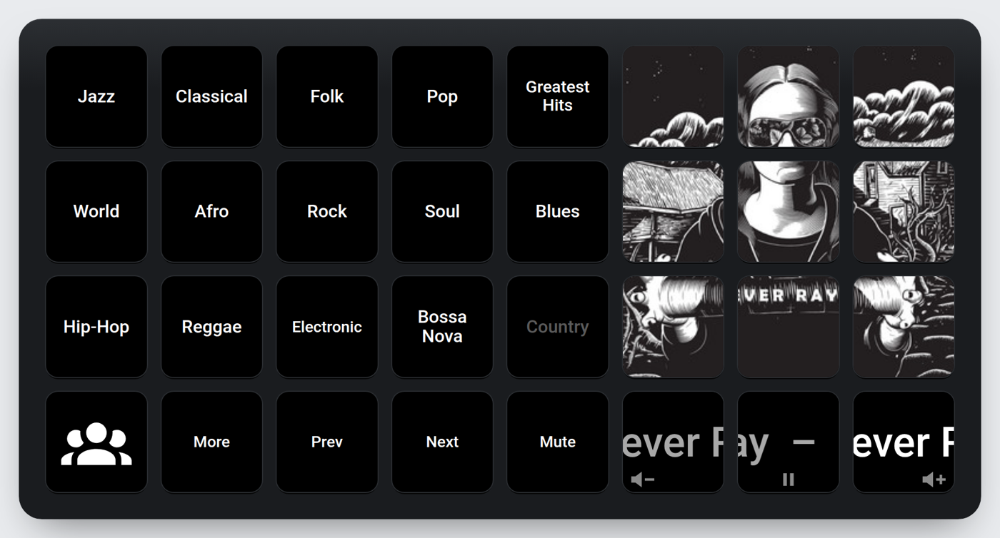
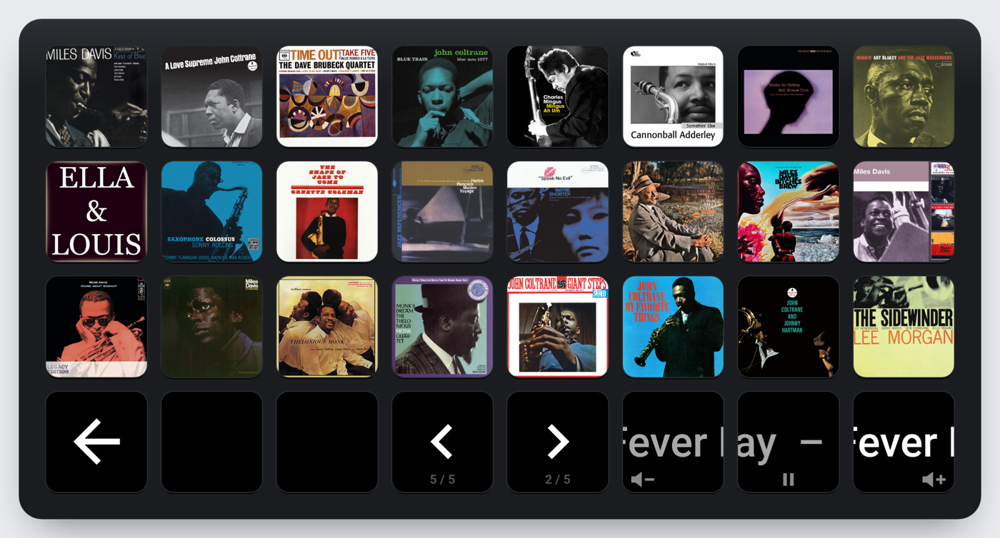
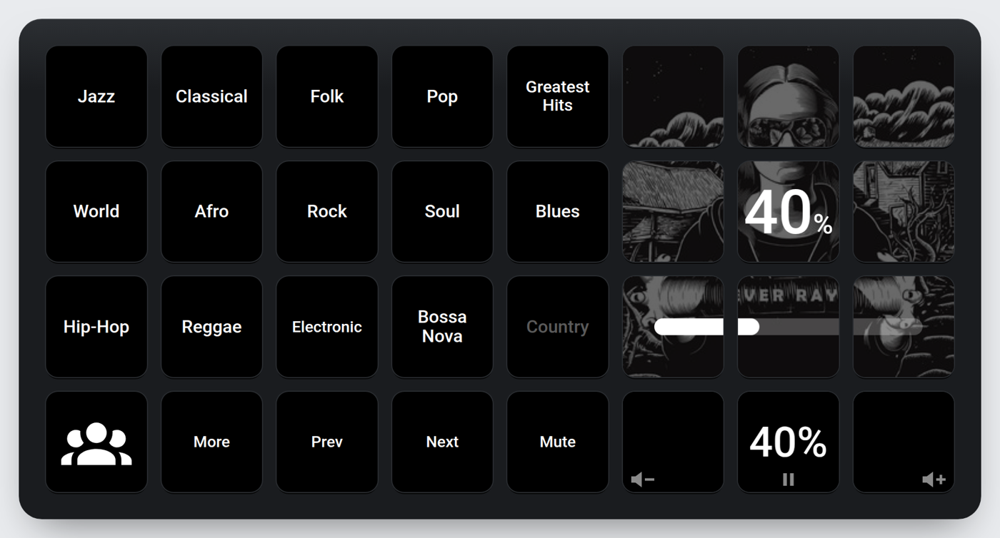
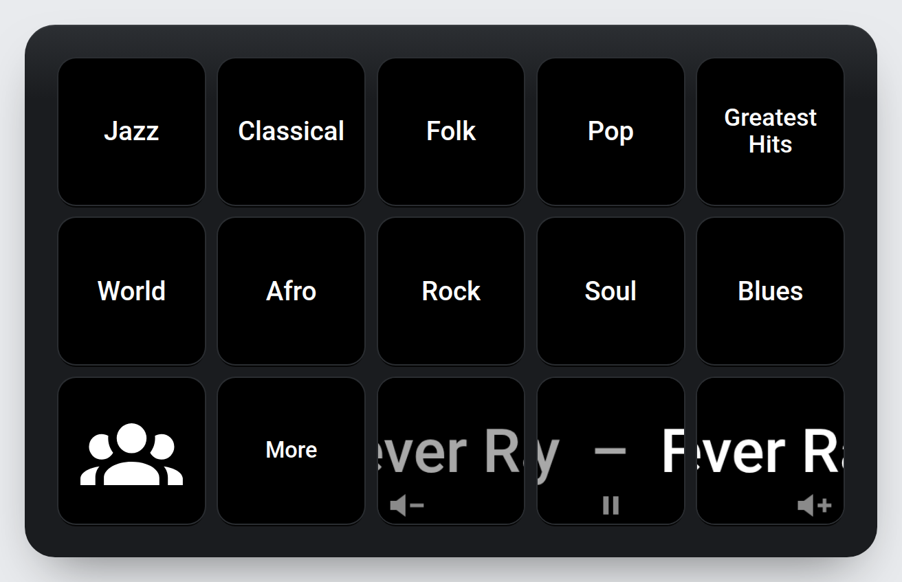
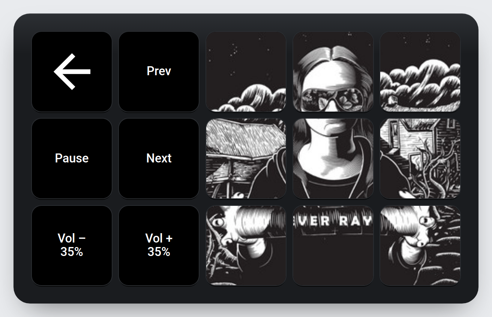
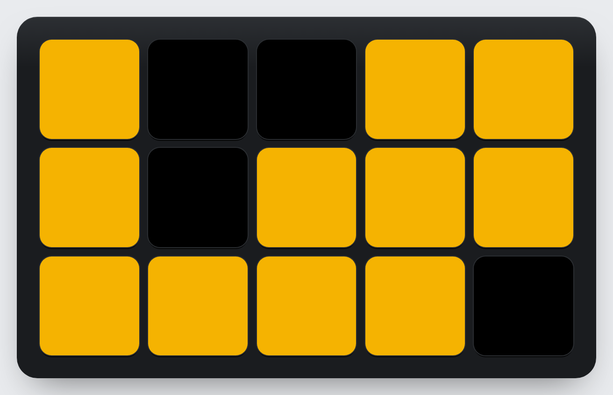

# Streamdeck Hautomate

**A Stream Deck that plays your record collection.** Each key is an album cover; tap one and it
plays on your speaker through Home Assistant and Spotify. Genres, a 500-album "greatest hits"
crate, a folder for everyone in the house that they fill by voice, a scrolling now-playing line,
volume that feels right, and a few toys (a sleep timer, sound effects, karaoke on the TV, a
Lights Out game and a music visualizer that turns the keys into a spectrum analyser).

Works with the **Stream Deck XL (32 keys)** and the **Stream Deck MK.2 / original (15 keys)**,
and comes with a browser emulator, so you can try every page before you own a deck.



| Album page (XL) | Volume across the cover (XL) |
|---|---|
|  |  |

| Home (15 keys) | Now Playing (15 keys) | Lights Out (15 keys) |
|---|---|---|
|  |  |  |

## What it does

- **Albums as keys.** Genres open pages of covers (24 a page on the XL, 10 on the 15-key deck);
  tap a cover and it plays, and the deck shows that album big on the Now Playing page. ‹ › flip
  pages (hold to jump five) and show the page number they go to. More › Random plays any album.
- **Now Playing panel** (XL): the current cover cut across a 3×3 block of keys, cropped around the
  gaps between keys so it reads as one picture, and under it "artist – song" scrolling slowly
  across three keys in large type.
- **Volume that feels right.** The keys under the scrolling line are Vol –, play/pause and Vol +.
  Taps step 1% when it's quiet and more as it gets louder; slow taps (or going back the other
  way) fine-tune in 1% steps; a quick run of taps jumps 5%, then 10%; holding slides all the
  way in three seconds. While it changes, the level shows big across the cover.
- **A folder for each person.** "Hey Home Assistant, add Kind of Blue to Alex" puts it on Alex's
  page; or hold an empty key and say what to add, or hold it and start something on Spotify.
  Hold a cover for 2.5 s, then tap it again, to remove it.
- **Albums with checked IDs.** Lists are plain JSON. `albums/add.py` takes "Artist ⇥ Title" lines,
  finds each album on Spotify, keeps only real matches (artist and title), prefers the standard
  edition and caches the cover. Comes with 14 genres and Rolling Stone's 500 Greatest Albums.
- **More:** the speaker's inputs and power (Amp), a sleep timer that turns everything off,
  sound effects on a second speaker over the music, the TV (power and films from Jellyfin),
  karaoke on the TV's YouTube app, Lights Out on the whole deck, and the visualizer.
- **Back to Home** after a minute untouched; Back is the same arrow everywhere.
- **Emulator.** `emulator/streamdeck-emulator-local.html` is the same deck in a browser, offline,
  with a simulated house (Dev) or wired to your real Home Assistant (Live). It also shows up in
  Home Assistant's sidebar.

## How it fits together

```
settings.yaml, albums/*.json, people/*.json ──► gen_config.py ──► configuration.yaml ──► the deck (Docker)
                                                               └─► emulator/build.py ──► the emulator page
homeassistant/*.yaml ──► tools/install_ha.py ──► Home Assistant packages (play, volume, sleep, TV, games…)
manager/deck_manager.py: voice and "listen mode" edits to people's folders
```

The deck runs [home-assistant-streamdeck-yaml](https://github.com/basnijholt/home-assistant-streamdeck-yaml)
in Docker, with `visualizer/deck_run.py` adding the Now Playing panel, the scrolling line, the
volume behaviour, hold-to-delete, Now Playing navigation and idle-to-Home on top.
[docs/how-it-works.md](docs/how-it-works.md) has the details.

## Get started

You need a Linux computer with Docker and the deck plugged in, Home Assistant with the Spotify
integration, and a speaker Spotify Connect can play to (a WiiM, Sonos, Chromecast…).

```sh
git clone https://github.com/samperet/Streamdeck-Hautomate.git && cd Streamdeck-Hautomate
cp settings.example.yaml settings.yaml        # your deck size, speaker, TV, people, genres
python3 gen_config.py                         # builds configuration.yaml and the emulator page
xdg-open emulator/streamdeck-emulator-local.html   # try it in Dev mode
```

Then connect Home Assistant and start the deck: [docs/setup.md](docs/setup.md) walks through it,
and [docs/configuration.md](docs/configuration.md) covers every setting, adding albums and
genres, people's folders, sounds and films.

## Credits

- [home-assistant-streamdeck-yaml](https://github.com/basnijholt/home-assistant-streamdeck-yaml)
  by Bas Nijholt drives the deck.
- `albums/top500.json` is Rolling Stone's 500 Greatest Albums of All Time (2020), from The Pudding's
  dataset as published by [TidyTuesday](https://github.com/rfordatascience/tidytuesday/tree/main/data/2024/2024-05-07) (2024-05-07).
- Icons: [Material Design Icons](https://pictogrammers.com/library/mdi/).

Album art shown in the screenshots belongs to its owners. MIT licensed: see [LICENSE](LICENSE).
